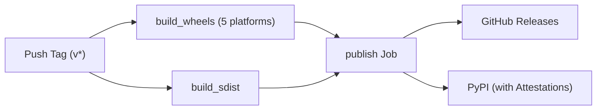

# Publishing Guide & PyPI Trusted Publishing Setup

This document provides instructions on how to set up and manage automated releases to **PyPI** and **GitHub Releases** for `betterleaks-py`.

The release pipeline uses **OpenID Connect (OIDC) Trusted Publishing** and generates **PEP 740 digital attestations** for provenance. No long-lived PyPI API tokens or passwords need to be stored in GitHub Secrets.

---

## 1. PyPI Configuration (Trusted Publisher)

To enable GitHub Actions to publish packages to PyPI tokenlessly:

1. Log in to your [PyPI account](https://pypi.org/).
2. Navigate to **Account Settings** -> **Publishing** ([pypi.org/manage/account/publishing/](https://pypi.org/manage/account/publishing/)).
3. Scroll down to **"Add a publisher"** and select **GitHub**.
4. Fill in the following details:
   - **PyPI Project Name**: `betterleaks-py` *(if publishing the first time, you may register it as a pending publisher under your user account)*
   - **Owner**: `as1605` (or the repository owner / organization)
   - **Repository name**: `betterleaks-py`
   - **Workflow name**: `build-wheels.yml`
   - **Environment name**: `pypi`
5. Click **"Add"**.

---

## 2. GitHub Repository Configuration (Environment)

To match the environment configured on PyPI and ensure proper deployment tracking:

1. In the GitHub repository, go to **Settings** -> **Environments**.
2. Click **"New environment"** and name it:
   ```
   pypi
   ```
3. *(Optional)* Configure deployment protection rules (such as requiring manual approval before publishing to PyPI) if desired.
4. Save the environment.

---

## 3. How the Publishing Pipeline Works

The workflow is defined in [`.github/workflows/build-wheels.yml`](../.github/workflows/build-wheels.yml):



1. **Trigger**:
   - The `publish` job runs automatically whenever a git tag matching `v*` (e.g. `v2.0.0-rc.5`, `v2.0.0`) is pushed to the repository:
     ```yaml
     if: startsWith(github.ref, 'refs/tags/v')
     ```

2. **Artifact Collation**:
   - Downloads all wheel artifacts (`cibw-wheels-*`) and the source distribution (`cibw-sdist`) into the `dist/` directory using `actions/download-artifact@v4` with `pattern: cibw-*` and `merge-multiple: true`.

3. **GitHub Release**:
   - Uses `softprops/action-gh-release` with `files: dist/*` and auto-generated release notes.

4. **PyPI Publish**:
   - Authenticates via OIDC (`permissions: id-token: write`) against PyPI's Trusted Publisher.
   - Uploads all distribution files in `dist/` using `pypa/gh-action-pypi-publish@v1.12.4`.
   - Generates cryptographic PEP 740 provenance attestations (`attestations: true`).

---

## 4. Triggering a Release

To release a new version of `betterleaks-py`:

1. Update the version string in [`src/betterleaks/__init__.py`](../src/betterleaks/__init__.py):
   ```python
   __version__ = "2.0.0"
   __upstream_version__ = "2.0.0"
   ```
2. Commit and push the version bump to `main`:
   ```bash
   git commit -am "chore: bump version to 2.0.0"
   git push origin main
   ```
3. Tag the commit and push the tag:
   ```bash
   git tag v2.0.0
   git push origin v2.0.0
   ```
4. Monitor the workflow execution under the **Actions** tab on GitHub. Once completed:
   - The release assets will be available on the GitHub Releases page.
   - The package will be live on PyPI at [`https://pypi.org/project/betterleaks-py/`](https://pypi.org/project/betterleaks-py/).

---

## 5. Troubleshooting & Verification

- **OIDC token error**: Ensure the GitHub repository name, owner, and workflow filename (`build-wheels.yml`) in PyPI's Trusted Publisher settings match the repository exactly.
- **Environment mismatch**: If you configure an environment on PyPI (e.g. `pypi`), the GitHub Actions job must specify `environment: { name: pypi }`.
- **Pre-upload validation**: The workflow runs `twine check --strict` on the built distribution packages before publishing to ensure metadata compatibility.
