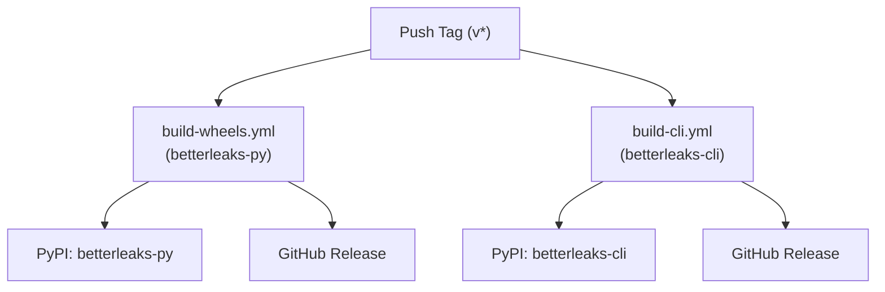

# Publishing Guide & PyPI Trusted Publishing Setup

This document provides instructions on how to set up and manage automated releases to **PyPI** and **GitHub Releases** for both distributions in this repository:
- **`betterleaks-py`**: Python bindings (loaded via CGO ctypes)
- **`betterleaks-cli`**: Standalone CLI binary executable

Both release pipelines use **OpenID Connect (OIDC) Trusted Publishing** and generate **PEP 740 digital attestations** for provenance. No long-lived PyPI API tokens or passwords need to be stored in GitHub Secrets.

---

## 1. PyPI Configuration (Trusted Publishers)

To enable GitHub Actions to publish packages tokenlessly, configure Trusted Publishers on PyPI:

### Publisher 1: `betterleaks-py` (Python Bindings)
1. Log in to your [PyPI account](https://pypi.org/).
2. Navigate to **Account Settings** -> **Publishing** ([pypi.org/manage/account/publishing/](https://pypi.org/manage/account/publishing/)).
3. Under **"Add a publisher"**, select **GitHub**.
4. Fill in:
   - **PyPI Project Name**: `betterleaks-py`
   - **Owner**: `as1605`
   - **Repository name**: `betterleaks-py`
   - **Workflow name**: `build-wheels.yml`
   - **Environment name**: `pypi`
5. Click **"Add"**.

### Publisher 2: `betterleaks-cli` (Standalone CLI)
1. Under **"Add a publisher"**, select **GitHub** again.
2. Fill in:
   - **PyPI Project Name**: `betterleaks-cli`
   - **Owner**: `as1605`
   - **Repository name**: `betterleaks-py`
   - **Workflow name**: `build-cli.yml`
   - **Environment name**: `pypi-cli`
3. Click **"Add"**.

---

## 2. GitHub Repository Environments

In the GitHub repository, navigate to **Settings** -> **Environments** and create two environments:

1. `pypi` (used by `build-wheels.yml` for `betterleaks-py`)
2. `pypi-cli` (used by `build-cli.yml` for `betterleaks-cli`)

*(Optional)* Configure deployment protection rules (such as manual approval) if desired.

---

## 3. How the Publishing Pipelines Work



1. **Trigger**:
   - Pushing any git tag matching `v*` (e.g. `v2.0.0`) triggers both workflows in parallel.
2. **`build-wheels.yml`**:
   - Compiles the CGO shared library (`libbetterleaks.so/.dylib/.dll`) across 5 platforms.
   - Publishes `betterleaks-py` wheels and sdist to PyPI and GitHub Releases.
3. **`build-cli.yml`**:
   - Compiles the standalone Go CLI binary across Linux, macOS, and Windows.
   - Retags wheels as universal `py3-none-<platform>` wheels.
   - Publishes `betterleaks-cli` wheels and sdist to PyPI and attaches them to GitHub Releases.

---

## 4. Triggering a Release

1. Update the version string in [`src/betterleaks/__init__.py`](../src/betterleaks/__init__.py) and [`cli/src/betterleaks_cli/__init__.py`](../cli/src/betterleaks_cli/__init__.py).
2. Commit and push:
   ```bash
   git commit -am "chore: bump version to 2.0.0"
   git push origin main
   ```
3. Tag and push:
   ```bash
   git tag v2.0.0
   git push origin v2.0.0
   ```
4. Once completed, both packages will be live:
   - Python library: [`https://pypi.org/project/betterleaks-py/`](https://pypi.org/project/betterleaks-py/)
   - Standalone CLI: [`https://pypi.org/project/betterleaks-cli/`](https://pypi.org/project/betterleaks-cli/)
